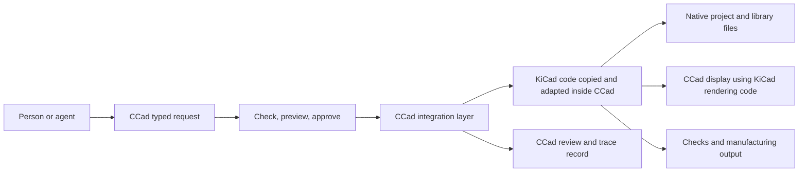

# Replacing the CCad CAD core with KiCad code

## Direction

<mark style="background-color:#ffd1d1">CCad will copy and adapt the KiCad source code it needs, compile that code as part of CCad, and ship the required dependencies and resources with the product. Users will not need a separate KiCad installation or process. We intend to remove `ccad_core` and its duplicate CAD implementation. Useful CCad features, such as agent requests, approval, review, and tracing, will be carried into the new product and connected to the KiCad-derived code.</mark>

This is source-code reuse, not only compatibility with KiCad file formats. KiCad-derived code will own the design objects and perform file reading and writing, editing, undo, checks, library use, and rendering inside the CCad product. CCad's agent layer will describe requested actions, request approval, and show what happened. For example, an agent can request "move U3 by 2 mm to the right"; the reused code resolves the native footprint, performs the move, and saves the native project.

"Copy and adapt" means bringing coherent parts of the KiCad source and their needed dependencies into this project. We will not copy isolated source files without their supporting code, build definitions, resources, and license terms. We will record the KiCad source revision and local changes for every imported part. The goal is one self-contained CCad product, not a wrapper around a separately installed KiCad application.

## Why change direction

The original research favored a separate typed CCad engine because the KiCad automation options it examined did not cover every workflow. Typed actions remain useful, but that does not require CCad to own a second CAD model or reimplement KiCad behavior.

Later source audits found specific CCad paths that reported success without fully loading or saving a tested board, along with selected identity, geometry, and output gaps. These are findings about named files and tested cases, not proof that every CCad workflow fails. They do show why file-format similarity alone is insufficient and why the implementation should reuse code that already understands KiCad designs.

## Target architecture

The diagram describes the intended design, not a working implementation. The shipped application must include its required code, libraries, and resources. A CCad cache may help with search or display, but it must be rebuildable from the native design and must never become a competing editable design.

## Migration order

**First, pin the source and map its dependencies.** Choose a stable KiCad source revision. Record the files and modules to reuse, their build and resource requirements, per-file license notices, and bundled third-party terms.

**Next, bring a coherent code slice into CCad.** Copy and adapt the needed source and dependency closure in the CCad repository. Build and package it from the CCad project so the result does not rely on a separate KiCad installation.

**Then, move design ownership.** Use the adapted code for project lifecycle, native files, board and schematic objects, libraries, rendering, and save/reopen behavior. Connect CCad typed requests through a small integration layer that calls those operations and reports real success or clear failure.

**Then, carry over useful CCad features.** Move the agent workflows, approval, review, traceability, and other product behavior that remains useful. Route board and schematic editing, connectivity, rules, routing, zone filling, and manufacturing through the bundled KiCad-derived implementation.

**Finally, remove the duplicate core.** Once the required workflows use the new path, delete `ccad_core`, its duplicate design model and CAD services, obsolete serializers and import/export code, duplicate renderers, build targets, tests, and documentation. Record features that are not yet supported. After the cut, fix defects in the KiCad-derived path rather than recreating the old kernel.

The product does not need perfect feature parity before the cutover. It does need dependable native saving and clear refusal when a request cannot be handled safely. Acceptance should cover opening a real project, making a typed edit, saving, closing, reopening, undoing, and checking that identities, connections, and untouched data remain intact. A separate KiCad installation may be used as an independent development-time checker; it must not be a runtime requirement of the shipped CCad product.

## What the audit has and has not established

The remediation package contains source inventories, focused audits, preserved probe results, and follow-up checklists. Examples include a tested board fixture that became empty through one named parser/plugin path, a save call that reported success without creating the requested file, and selected placement or export paths with identity, geometry, or completeness problems. These examples explain the motivation; they do not amount to a complete audit or a repaired product.

The KiCad exploration reached selected PCB API and board files, typed request definitions, handlers, and commit behavior in the development checkout at revision `e785bc87b0e70dbf8f767367f8d68fc8ccfcec0d`. It found reusable source and request patterns, while leaving broad areas and runtime behavior unverified. That development checkout is not the KiCad 10.0.7 stable release source. Pin and recheck the source revision used for the actual migration.

The existing checklists remain work queues. A checked-in report, source inspection, or prototype would not by itself prove the whole project works. Keep evidence tied to the exact code revision, test, fixture, and behavior it covers.

## Important constraints

KiCad is GPL-licensed, and individual files, bundled libraries, and assets may have additional terms. Preserve notices and complete a distribution-license review before shipping. Reused code and dependencies also need to be built, packaged, updated, and tested together as part of CCad. Track upstream source revisions and local patches so future fixes can be compared and carried forward deliberately.

The stable KiCad release identified in the 30 October 2026 research check was 10.0.7. The development source revision above is a separate snapshot. KiCad's IPC documentation describes release-dependent limits; IPC and CLI may help investigation, but the shipped CCad workflow must use the bundled code and cannot rely on a separate KiCad process.

## Research references

The 14 May 2026 research report explains why the initial design favored a separate typed engine. The KiCad IPC developer guide describes the limits of its automation interface: https://dev-docs.kicad.org/en/apis-and-binding/ipc-api/for-addon-developers/ . KiCad's S-expression format introduction describes its schematic, board, and library file syntax: https://dev-docs.kicad.org/en/file-formats/sexpr-intro/ . The detailed source reports and KiCad exploration handoff are maintained in the CCad Obsidian remediation and audit folders; the repository checklist links each open evidence task.
